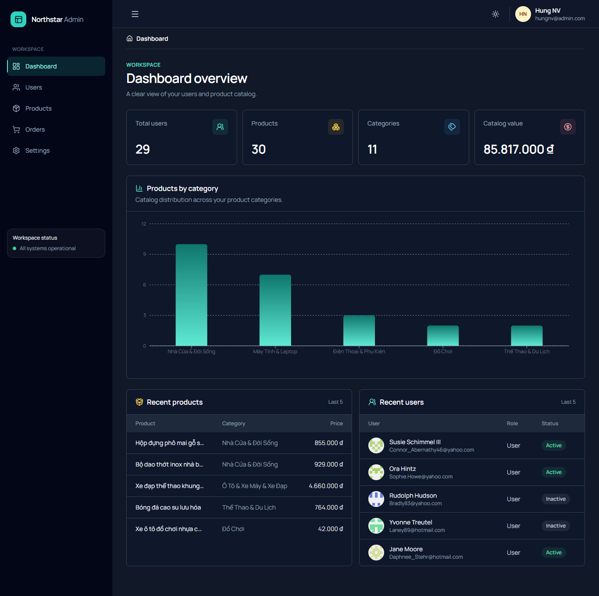
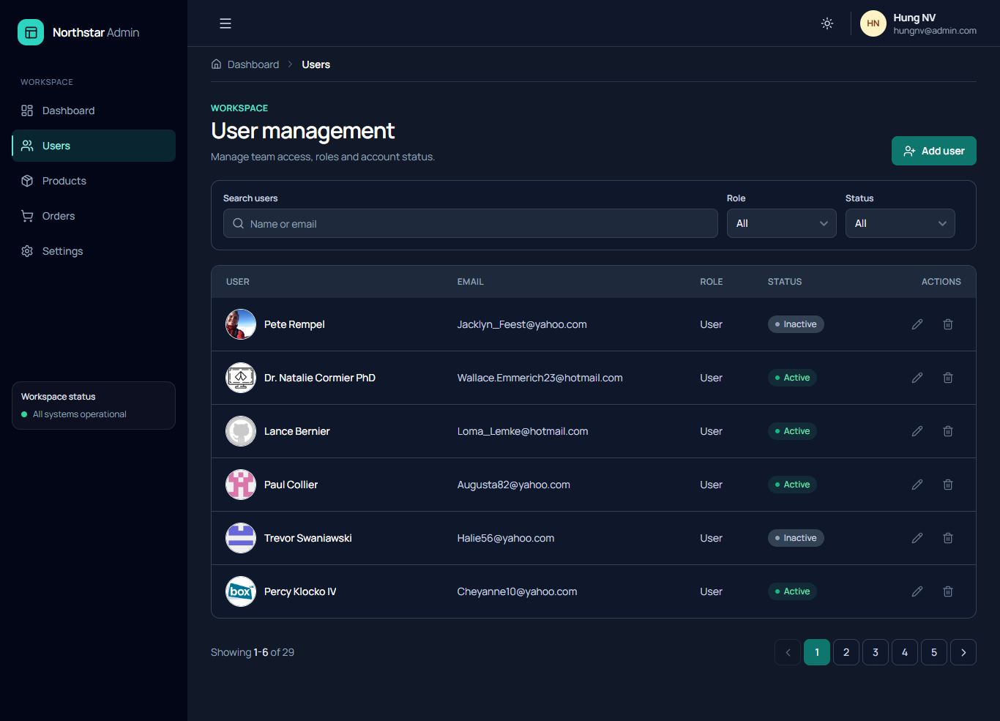
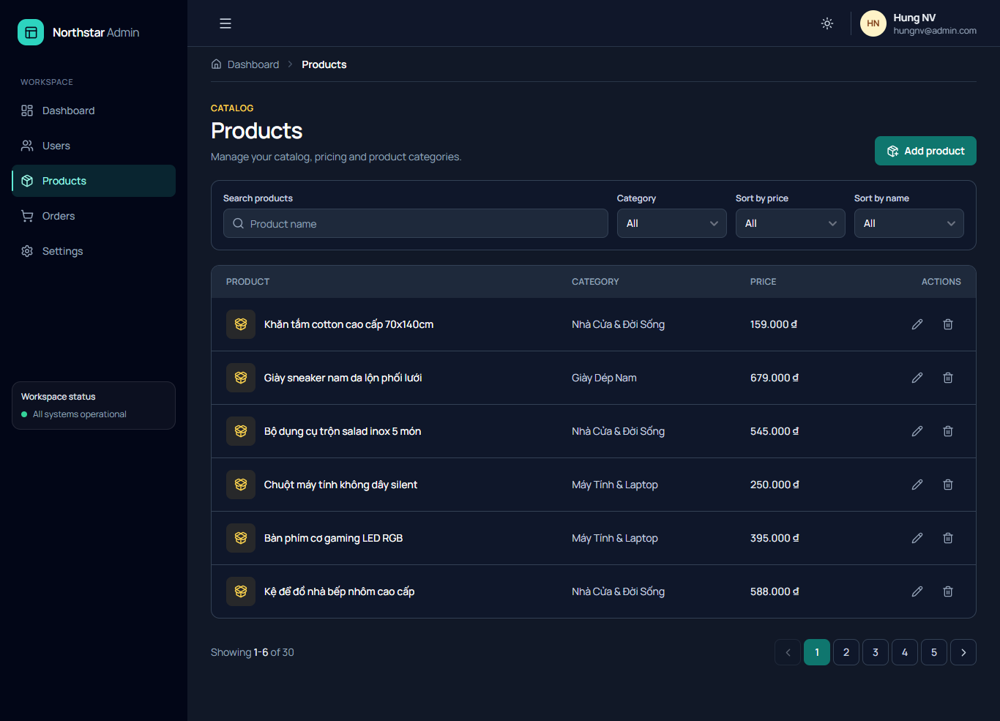

# React Dashboard

A responsive dashboard application built with React and TypeScript.

This project is a practical React project focused on building a dashboard with REST API integration, CRUD operations, search, filtering, pagination, form validation, and data visualization.

## 🚀 Live Demo

[View Live Demo](https://react-dashboard-six-gold.vercel.app/)

## 📸 Screenshots

### Dashboard



### User Management



### Product Management



## 🛠️ Tech Stack

* React 18
* TypeScript
* Vite
* React Router
* Tailwind CSS
* Axios
* TanStack Query
* Zustand
* React Hook Form
* Zod
* Recharts
* Lucide Icons
* React Hot Toast
* MockAPI

## ✨ Features

### Dashboard

* Display total users
* Display total products
* Display total categories
* Display total product value
* Product statistics
* Data visualization with Recharts
* Recent products
* Recent users

### User Management

* Get users from REST API
* Create user
* Update user
* Delete user
* Keyword search through the users API
* Combined role and status filtering (for example, Admin and Active)
* Client-side pagination with 6 users per page
* Debounced search (500 ms)
* Form validation with React Hook Form and Zod
* UI state managed with Zustand
* Server state and cache invalidation managed with TanStack Query
* Loading state
* Error handling
* Empty state

### Product Management

* Get products from REST API
* Create product
* Update product
* Delete product
* Pagination
* Search
* Filter by category
* Sort products
* Loading state
* Error handling
* Empty state

## 🔌 API

This project uses MockAPI as the backend REST API.
Set `VITE_API_URL` to the base URL of your MockAPI project. The frontend reads it through the shared Axios client.

### Users

```text
GET    /users
POST   /users
PUT    /users/:id
DELETE /users/:id
```

The Users feature requests matching users from the API, applies role and status filters together, calculates the filtered total, and then slices the result into pages of 6. A filter value of `All` is not sent as an API filter.

### Products

```text
GET    /products
POST   /products
PUT    /products/:id
DELETE /products/:id
```

## 📂 Project Structure

```text
src/
├── api/
│   └── axiosClient.ts
│
├── components/
│   ├── dashboard/
│   ├── layouts/
│   ├── products/
│   └── users/
├── features/
│   └── users/
│       ├── api/
│       ├── components/
│       ├── hooks/
│       ├── queryKeys/
│       ├── schemas/
│       ├── store/
│       └── types/
├── pages/
├── router/
└── App.tsx
```

The Users page composes feature components. TanStack Query owns users data and request state; the Zustand store owns UI state such as search, filters, pagination, and modal selection.

## 💻 Getting Started

### 1. Clone the repository

```bash
git clone https://github.com/HungNV060895/react-dashboard.git
```

### 2. Install dependencies

```bash
npm install
```

### 3. Configure the API URL

Copy `.env.example` to `.env` and set the base URL for your MockAPI project:

```env
VITE_API_URL=https://your-project.mockapi.io/api/v1/
```

### 4. Start the development server

```bash
npm run dev
```

The application will run at:

```text
http://localhost:3000
```

### 5. Build for production

```bash
npm run build
```

## 🧠 What I Learned

Through this project, I practiced:

* Building reusable React components
* Managing local component state with React
* Handling side effects with `useEffect`
* Working with TypeScript
* Building forms with React Hook Form and Zod
* Integrating REST APIs with Axios
* Implementing CRUD operations
* Managing server state and query caching with TanStack Query
* Managing shared feature UI state with Zustand
* Implementing debounced search, filtering, and pagination
* Handling loading, error, and empty states
* Building dashboard statistics
* Creating charts with Recharts
* Structuring a React application
* Working with Git and GitHub

## 🔮 Future Improvements

Potential future improvements:

* Authentication
* Automated tests
* Improved error handling
* Performance optimization
* Better responsive UI

## 👨‍💻 Author

HungNV

Frontend Developer
